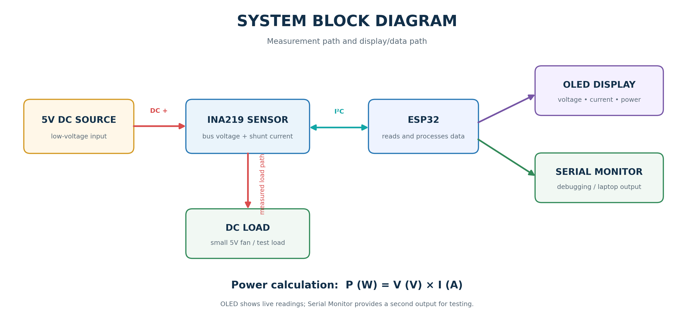
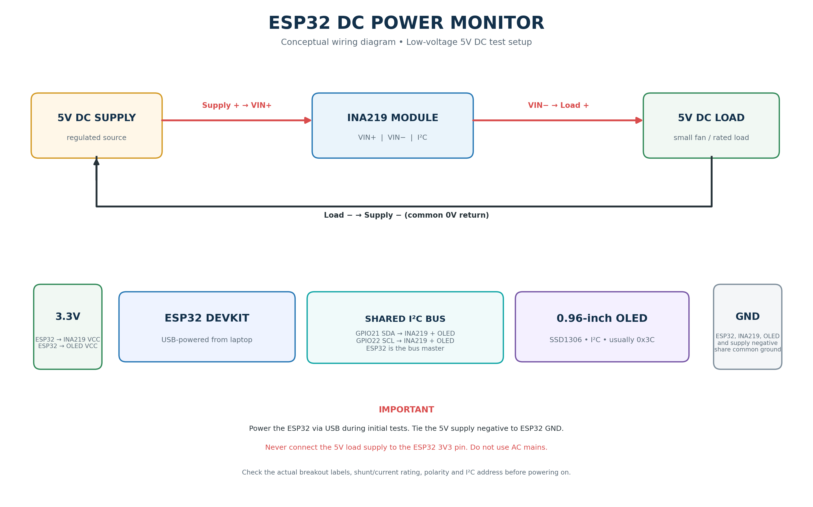
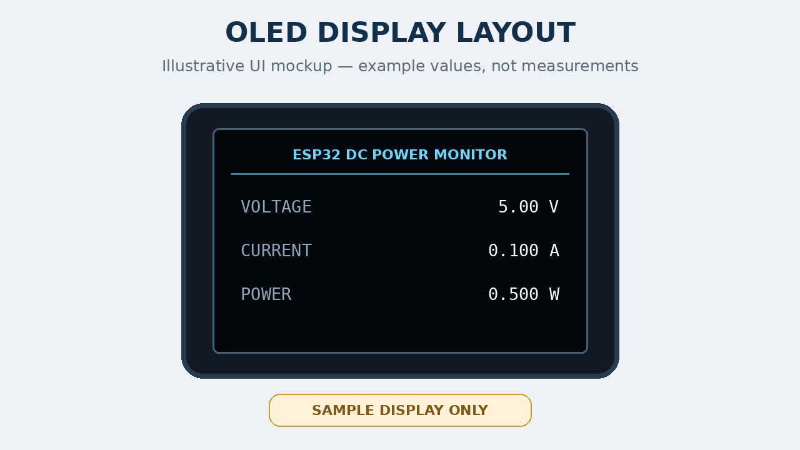

# ESP32 DC Power Monitor

An ESP32-based DC power monitoring project designed to measure voltage, current, and power using an INA219 sensor and display the readings on an SSD1306 OLED.

**Project Status:** In Progress — hardware assembly and physical testing are pending.

## 1. Project Overview

The ESP32 DC Power Monitor is an embedded electronics project intended to monitor the electrical parameters of a low-voltage DC load.

The INA219 sensor measures bus voltage and shunt voltage. The ESP32 reads the sensor data through I2C, calculates or retrieves power values, and displays the readings on an OLED display.

## 2. Project Objectives

- Monitor DC voltage.
- Measure load current.
- Calculate electrical power.
- Display readings on an OLED screen.
- Learn ESP32 sensor interfacing and I2C communication.

## 3. Main Features

- DC voltage monitoring
- DC current measurement
- Power monitoring
- ESP32-based data processing
- SSD1306 OLED display interface
- Serial Monitor output for debugging

## 4. Components Required

| No. | Component | Purpose |
|---|---|---|
| 1 | ESP32 DevKit | Main controller |
| 2 | INA219 Sensor Module | Voltage and current sensing |
| 3 | 0.96-inch SSD1306 OLED | Display output |
| 4 | Breadboard | Circuit assembly |
| 5 | Jumper Wires | Electrical connections |
| 6 | Regulated 5V DC Supply | Power source |
| 7 | 5V DC Fan | Test load |
| 8 | Digital Multimeter | Measurement verification |
| 9 | USB Data Cable | Programming ESP32 |

## 5. System Block Diagram

## 6. Circuit Connection Diagram

The INA219 and OLED can share the ESP32 I2C bus.

Typical connections for a classic ESP32 DevKit:

| Module Pin | ESP32 Pin |
|---|---|
| INA219 SDA | GPIO 21 |
| INA219 SCL | GPIO 22 |
| OLED SDA | GPIO 21 |
| OLED SCL | GPIO 22 |
| Module GND | Common GND |
| Module VCC | 3.3V, if supported by the breakout |

Verify the actual board pinout and module labels before connecting hardware.

## 7. Working Principle

1. A regulated DC supply provides power to the load.
2. The load current flows through the INA219 sensor's shunt measurement path.
3. INA219 measures bus voltage and shunt voltage.
4. ESP32 reads sensor data using I2C communication.
5. Voltage, current, and power readings are sent to the OLED display.

### Power Calculation

The electrical power is calculated using:

P = V × I

Where:

- P = Power in Watts (W)
- V = Voltage in Volts (V)
- I = Current in Amperes (A)

## 8. OLED Display Layout

The OLED mockup shows the planned interface. Its sample readings are illustrative and are not actual hardware measurements.

## 9. Software and Tools

- Arduino IDE
- ESP32 Arduino Core
- Adafruit INA219 Library
- Adafruit SSD1306 Library
- Adafruit GFX Library
- Wokwi Simulator

## 10. Laptop Simulation

The current starter simulation is intended for practising ESP32 and OLED display programming.

Important limitation:

The standard Wokwi setup included here does not simulate the INA219 sensor. Simulation readings are generated demo values and do not represent real voltage or current measurements.

## 11. Safety Precautions

- Start with a regulated low-voltage 5V DC supply.
- Never connect AC mains directly to this circuit.
- Verify the INA219 breakout's shunt and current ratings.
- Check polarity and common ground before powering the circuit.
- Compare physical readings with a multimeter during testing.

## 12. Project Status

- [x] Initial project documentation
- [x] System block diagram
- [x] Proposed circuit connection diagram
- [x] Starter Arduino sketch
- [x] OLED interface mockup
- [ ] ESP32 and INA219 hardware assembly
- [ ] Physical sensor testing
- [ ] Multimeter verification
- [ ] Final hardware photographs

## 13. Future Improvements

- Add Wi-Fi-based monitoring.
- Develop a live web dashboard.
- Add energy consumption measurement in Wh.
- Improve the display interface.
- Design a permanent PCB version.

## 14. Repository Documents

- [Project Report](PROJECT_REPORT.md)
- [Components and Purchase Checklist](COMPONENTS_AND_PURCHASE_CHECKLIST.md)
- [Laptop-Only Workflow](LAPTOP_ONLY_WORKFLOW.md)
- [Testing Plan](TEST_PLAN.md)
- [Viva Preparation](VIVA_PREP_HINGLISH.md)
- [Wokwi Libraries](libraries.txt)

## 15. Author

**VANSH KUMAR**

Electronics Engineering Student

GitHub: [VanshukT](https://github.com/VanshukT)

---

This project is currently under development. Physical implementation and measurement results will be added after hardware assembly and testing.
